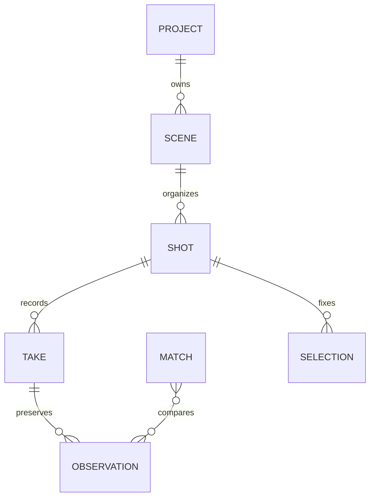

# 领域与本体设计

## 专业聚合

Evidence固定引文、Scene剧本场次、Shot镜次、Take条次声明、Observation连续性观察、Match连续性比较、Selection剪辑选择、Note固定意见。根字段：evidence、scenes、shots、takes、observations、matches、selections、notes、basis_refs。专业对象以WorkRef＋owner_plugin_id＋object_id确定身份，revision＋sha256固定内容。相同标题不代表同一对象。

场次故事日、场景、人物及镜次明确；条次记录只追加，mode分为人工记录与模拟。入出帧使用整数和精确有理帧率，不以毫秒近似代替时间码；不支持drop-frame时间码换算。连续性观察按角色或道具、类别、状态位置及入出分别记录；比较绑定确切两条和明确匹配项，缺观察返回unknown，允许作者明确有意变化并说明。剪辑选择固定当前场次镜次及条次组合摘要，剧本或镜次改变后旧选择待复核；不把选择记为宿主素材采用。已记录条次及旧观察不覆盖，新证据追加。

所有集合ID唯一、所有引用存在、集合有界、顺序在对应父级唯一。撤销先处理依赖，不能制造悬空引用；来源索引只追加，整本保存不能改变原索引意义。跨包引用只携带固定Owner、对象、修订与摘要，通过公开SDK回读，不导入对方私有结构。

## 权属

原始资料、作品身份与受管事务归Core；专业记录归本包；理解、创作与解释归作者选择的外部Agent；表达取舍与定稿归作者。借助欧卡姆原理复用通用事实，只增加本旅程需要的专业状态。
